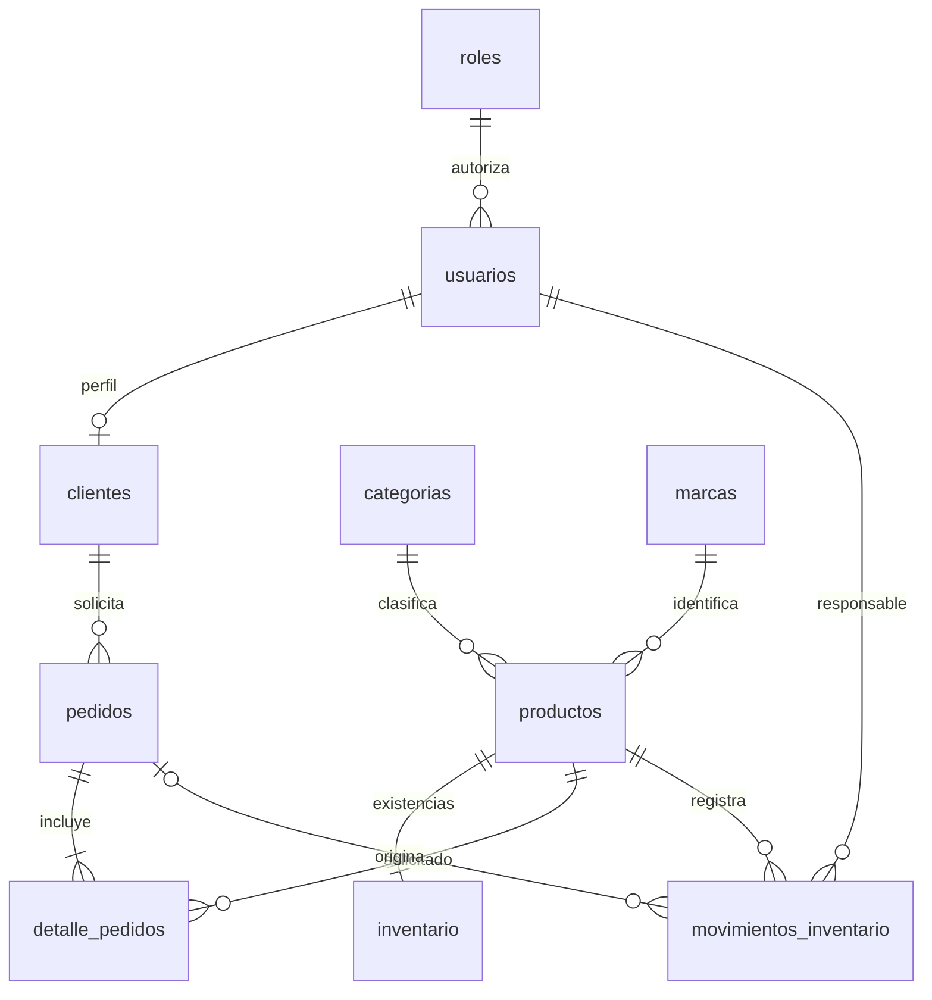

# Modelo relacional de la tienda

Base predeterminada `NovaObraTienda`. El esquema está en `database/schema.sql`; el asistente selecciona la base antes de ejecutarlo. No ejecutarlo dentro de la base de NovaObra Control. MySQL 8.0.16+, InnoDB, claves foráneas activas, UTF-8. No hay tabla adicional de migraciones o sesiones.

| Tabla | Responsabilidad y restricciones |
| --- | --- |
| roles | Tres roles: administrador, empleado y cliente; nombre único |
| usuarios | Nombre, email único, hash scrypt, rol, acceso activo y versión de sesión |
| clientes | Perfil opcional 1:1 de usuario; teléfono y dirección de contacto |
| categorias | Nombre único, descripción y estado activo |
| marcas | Nombre único, descripción y estado activo |
| productos | SKU único, marca/categoría, contenido comercial, imagen principal, precio/oferta y fechas |
| inventario | Una fila por producto, existencias y mínimo no negativos |
| pedidos | Cliente, tipo, estado, entrega, instantánea de dirección/teléfono, costo de entrega e idempotencia |
| detalle_pedidos | Un producto por pedido, cantidad positiva, precio unitario pactado |
| movimientos_inventario | Cantidad con signo, responsable, motivo y pedido opcional; historial inmutable en API |

**1FN:** cada columna contiene un valor del dominio; no se guardan listas de productos, reseñas, imágenes o sesiones en una celda. Las especificaciones se guardan como texto descriptivo indivisible, no como atributos filtrables estructurados. Cada línea del pedido tiene su propia fila.

**2FN:** las tablas usan claves simples. Las claves alternativas compuestas `(pedido_id, producto_id)` y `(cliente_id, clave)` identifican una línea y una solicitud completa; la cantidad y el precio pactado dependen de la línea, no solo del producto.

**3FN:** nombres de roles, categorías y marcas se obtienen mediante relaciones. La identidad del cliente vive en usuarios; no se repite en clientes. La dirección y el teléfono del pedido representan el destino/contacto al momento de solicitarlo; no dependen del perfil actual. El precio unitario pactado pertenece al detalle y no depende del precio comercial vigente. Los subtotales y totales se calculan al consultar; no se duplican en cabecera. La existencia es un saldo operativo actualizado con el movimiento en la misma transacción; esa redundancia entre saldo e historial es deliberada para concurrencia y requiere el servicio de inventario.

Índices en correo, SKU, categoría/marca, estado/fecha, cliente/clave y producto/fecha. El buscador usa `LIKE` parametrizado con comodines del usuario escapados; no ofrece búsqueda difusa ni índice full-text. Para catálogos grandes se debe medir y adaptar el índice de búsqueda.

El pedido se crea con precios recalculados y bloqueos de productos/inventario ordenados por ID. La clave de solicitud evita descuentos duplicados ante reintentos. La transición de estado bloquea la cabecera; la cancelación devuelve cada línea en orden de producto y solo la primera vez. Una cotización no modifica inventario.

La API no permite editar ni borrar movimientos o líneas históricas. Las FK impiden referencias inexistentes. Los `CHECK` impiden stock negativo, cantidades nulas o promociones inválidas incluso ante SQL directo.
